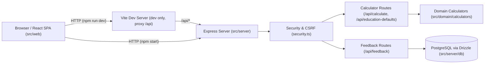

# Arah Dana (`arahdana`)

Aplikasi web perencanaan keuangan pribadi (**Arda — Arah Dana**) untuk mensimulasikan tujuan finansial secara lokal. Dibangun dengan **Express**, **React + Vite**, **TypeScript**, dan **PostgreSQL (Drizzle ORM)**.

Menyediakan 9 kalkulator finansial (**Investasi**, **Dana Darurat**, **DP Properti**, **Simulasi KPR**, **Kendaraan**, **Barang**, **Menikah**, **Dana Pensiun**, dan **Pendidikan Anak**), ekspor ringkasan hasil ke PNG (Canvas 2D), arsip `#CeritaUang`, serta form masukan pengguna.

## Cara Menjalankan

### Prasyarat
- Node.js `24.1.0` & npm `11.3.0`
- PostgreSQL 16 (database dev dan test terpisah)

Opsional, sediakan `public/fonts/Pally-Variable.woff2` dari Fontshare untuk memakai Pally. Berkas ini dikecualikan sesuai `public/fonts/Pally-FFL.txt`. Tanpa berkas tersebut, aplikasi memakai font cadangan Binder dan build tetap berjalan.

### 1. Konfigurasi & Migrasi
Salin `.env.example` menjadi `.env`, lalu isi `DATABASE_URL`, `TEST_DATABASE_URL`, dan `PORT` (default `3000`):

```sh
cp .env.example .env
npm ci
npm run db:migrate
npm run db:migrate -- --test
```

### 2. Mode Pengembangan (Hot Reload)
```sh
npm run dev
```
Membuka Vite dev server di `http://127.0.0.1:3000` (mengikuti `PORT` di `.env`, default `3000`) dan meneruskan request `/api/*` ke Express internal di port `3001` (`DEV_API_PORT`).

### 3. Mode Produksi Lokal
```sh
npm run build
npm start
```
Menyajikan hasil build frontend (`dist/`) dan API Express di `http://127.0.0.1:3000` (mengikuti `PORT`, fallback `3000`).

### 4. Typecheck & Tes
```sh
npm run typecheck
npm run build
npm test
```
Jalankan `npm run build` sebelum `npm test` agar tes HTTP/SPA dapat mengakses aset di `dist/`. Tes API menggunakan `TEST_DATABASE_URL`.

Tes pembanding arsip memakai `fixtures/source-excerpts.json` jika tersedia di lokal. Tes pembanding Python memerlukan Python 3 dan `ARDA_PARITY_BASELINE` yang menunjuk ke folder baseline lokal.

## Struktur Proyek

### Arsitektur & Alur Request


### Struktur Folder
```text
arahdana/
├── index.html                  # Entry HTML untuk Vite
├── migrations/                 # Migrasi SQL & metadata Drizzle Kit
├── public/                     # Aset statis (font & poster episode)
├── fixtures/                   # Fixture pembanding untuk tes
├── scripts/                    # Utilitas verifikasi PNG (verify-png.py)
├── src/
│   ├── domain/calculators/     # Rumus, tipe, skema Zod, & preset pendidikan
│   ├── server/
│   │   ├── app.ts              # Setup Express, routing API, & SPA fallback
│   │   ├── dev.ts              # Server dev (Vite HMR + proxy API Express)
│   │   ├── index.ts            # Entry server produksi (serve dist/)
│   │   ├── security.ts         # Header keamanan (CSP) & proteksi CSRF/Origin
│   │   ├── db/                 # Koneksi PostgreSQL, schema Drizzle, & migrator
│   │   └── modules/            # Route & service kalkulator serta feedback
│   └── web/
│       ├── app.tsx             # Routing SPA & state utama
│       ├── api.ts              # Client API & pengelolaan token CSRF
│       ├── binder/             # Layout shell & gaya tema Binder
│       ├── components/         # Beranda (Home) & dialog Feedback
│       ├── emergency/          # Alur form & hasil Dana Darurat
│       ├── conversational/     # Alur form, hasil, & KPR kalkulator lain
│       ├── export/             # Ekspor ringkasan hasil (Canvas 2D PNG)
│       └── styles/             # Design tokens CSS
└── tests/                      # Tes unit domain, API (DB nyata), paritas, & UI
```
